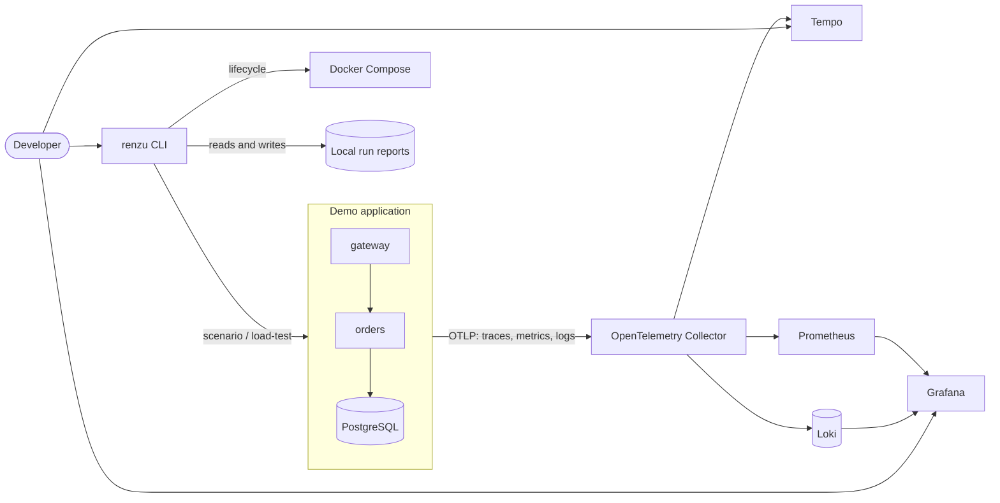
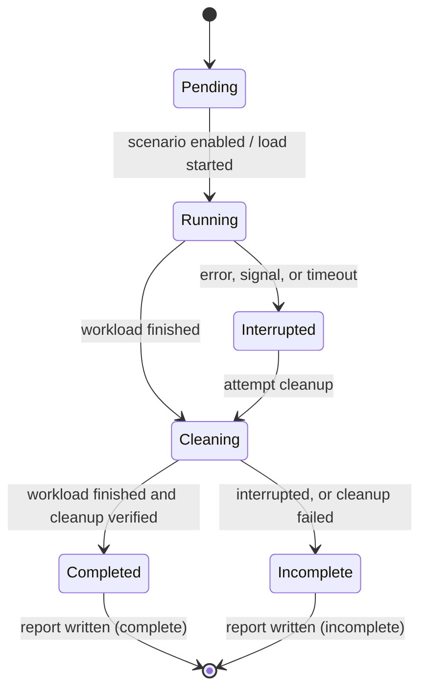

# ARCHITECTURE.md

> **Status:** Draft v0.0.0 (MVP implemented; target architecture below)
> **Source:** `PRD.md`
> **Detail:** Diagrams and per-component notes live in `docs/architecture/`. Decisions live in `docs/decisions/`.

This document describes the intended system boundaries and data flow and marks
the current MVP implementation state. `README.md`, `docs/FEATURES.md`, and the
ADRs in `docs/decisions/` are the current status sources when this target text
is stale. Nothing here is a claim of working behavior unless the marker says so.

| Marker | Meaning |
|---|---|
| **Planned** | Designed, not implemented |
| **Decision pending** | Blocked on an ADR (see Section 9) |
| **Implemented** | Feature is done and verified |

Update the markers as components land. Keep this file short; move detail into `docs/architecture/`.

---

## 1. Purpose and Scope

Renzu Observability is a local-first laboratory for reproducing, observing, and diagnosing distributed-system failures. It runs on one developer machine under Docker Compose and is controlled through a Rust CLI, `renzu`.

It composes existing observability tools. It does not replace Prometheus, Grafana, Tempo, Loki, or the OpenTelemetry Collector, and it does not implement its own storage or tracing backend. The Rust code in this project is the demo services, the load generator, the fault-injection controls, the report generator, and the CLI.

---

## 2. System Context

The diagram shows the implemented MVP shape. A `payments` service is a future
idea and is not part of the MVP (see Section 8).

---

## 3. Components

### 3.1 Demo application (**Implemented in MVP**)

A small set of independently running Rust services. Their purpose is to produce realistic, controllable distributed behavior, not business value.

| Service | Role | Status |
|---|---|---|
| `gateway` | Entry HTTP service with health, readiness, fault controls, and telemetry | Implemented |
| `orders` | Downstream dependency; creates a real cross-service request path | Implemented |
| PostgreSQL | Database dependency; target of latency and failure injection | Implemented |

`payments` remains a future idea; adding it is outside the MVP.

Every implemented service:

- Uses Tokio and Axum.
- Exposes health and readiness endpoints.
- Emits structured logs, traces, and metrics using `tracing` and OpenTelemetry-compatible export.
- Forwards an inbound `traceparent` header on outbound calls. A global W3C propagator is not installed, so service spans are not guaranteed to share a trace ID.
- Never logs credentials or sensitive payloads.

### 3.2 Telemetry pipeline (**Implemented in MVP**)

| Component | Responsibility | Status |
|---|---|---|
| OpenTelemetry Collector | Single ingest point (OTLP); batching and routing to backends | Implemented |
| Tempo | Trace storage and query (via Grafana) | Implemented (ADR-0006) |
| Prometheus | Metrics storage and query | Implemented |
| Grafana | Dashboards for metrics, Explore for traces/logs | Implemented |
| Loki | Log storage and query | Implemented (ADR-0002) |

Services export to the Collector rather than directly to backends. This keeps backend choices out of application code and makes the pipeline itself observable. Structured stdout logs remain for local reading; the same `tracing` events also become OTLP LogRecords routed through the Collector to Loki.

### 3.3 `renzu` CLI (**Implemented in MVP**)

A Rust binary built with `clap`. It orchestrates the environment and experiments. It does not sit on the request path. Each command lands together with the feature that needs it.

| Command | Responsibility | Milestone |
|---|---|---|
| Skeleton, help, exit codes | Conventions for errors and exit codes | Started early (after the first service) |
| `up`, `status`, `down` | Environment lifecycle; reports partial health honestly | M4 |
| `scenario list`, `scenario run <name>` | Apply and clean up a named fault scenario | M3 |
| `load-test --scenario <name>` | Generate traffic and record measurements | M3 |
| `report <run-id>` | Read and display a saved experiment report | M3 |

Implemented choice: the CLI drives Docker Compose directly with argument arrays. The compose file is selected by `--compose-file`, `RENZU_COMPOSE_FILE`, or `./compose.yaml`.

### 3.4 Load generator (**Implemented in MVP**)

Generates bounded, configurable traffic (duration plus rate or concurrency) and records request counts, errors, throughput, and latency percentiles. It is a library used by the CLI, introduced in M3. It rejects unsafe configurations to avoid exhausting the host.

### 3.5 Scenario and fault-injection mechanism (**Implemented in MVP**)

Scenarios are declarative, validated configuration. They are never executed as shell commands.

Implemented approach:

- Faults (database latency, error rate, downstream timeout) are enabled by application-level configuration, such as a control endpoint or configuration reload on the target service, rather than by manipulating the host.
- Control endpoints are disabled by default, enabled only through explicit configuration, and bound to `127.0.0.1`. Their parameters are bounded and validated.
- Each fault has explicit enable and disable operations.
- Cleanup is verified, not assumed. A failed cleanup is reported as a failure.
- Faults affect only project-owned containers.

### 3.6 Experiment reports (**Implemented in MVP**)

Each experiment produces one local report keyed by a unique run ID, written to disk so it can be read without a running CLI process.

A report records:

- Run ID, scenario name and configuration.
- Start time, duration, and completion status (`complete` or `incomplete`).
- Workload parameters.
- Success and failure counts and latency statistics.
- References to telemetry (for example trace IDs).
- Warnings, including any missing telemetry.

The storage format and location are decided in M3. Telemetry availability and experiment completion are tracked as separate fields.

---

## 4. Request and Telemetry Flow

1. The load generator (or a manual request) sends an HTTP request to the entry service.
2. The entry service starts a root span, then calls the downstream service and PostgreSQL. An inbound `traceparent` header is forwarded, but no global W3C propagator is installed, so the resulting service spans are not guaranteed to share one trace ID.
3. Each service emits logs, spans, and metrics using OTLP to the Collector.
4. The Collector batches telemetry and exports traces to Tempo, metrics to Prometheus, and logs to Loki.
5. The developer inspects traces in Grafana Explore (Tempo), metrics and dashboards in Grafana, and logs through Loki in Grafana Explore.

Metrics reach Prometheus through the Collector's Prometheus exporter at `:9464` (ADR-0005). Direct service scraping is not part of the MVP.

---

## 5. Cross-Signal Correlation

- **Logs to traces:** OTLP log records carry the trace ID and span ID of the active span. Loki stores those fields in the log line, and Grafana provisions a derived field that links a matching log to the Tempo trace. Trace-to-log UI linking is not configured, and `scripts/e2e-log-trace-correlation.sh` verifies only the log-to-trace path.
- **Metrics to traces:** Not implemented in the MVP. Do not claim exemplar or other metric-to-trace links.
- **Run reports to telemetry:** Reports store best-effort Tempo and Grafana Explore links built from client-generated `traceparent` IDs. Because no global propagator is installed, a link may not resolve to a service span. Reports do not copy telemetry.

Known correlation gaps must be documented next to the feature that has them.

---

## 6. Experiment Lifecycle

Rules:

- Every run has a unique run ID from creation.
- A run is `complete` only if the workload finished and cleanup was verified.
- Interrupted runs and failed cleanups produce a report marked `incomplete`, never silence.
- Missing or delayed telemetry is recorded as a warning, never interpreted as healthy behavior.

---

## 7. Cross-Cutting Concerns

**Failure semantics.** Startup and shutdown handle partial failure and report it. `renzu up` distinguishes fully healthy from partially healthy. `renzu down` does not claim success if required cleanup failed.

**Distinguishing faults from telemetry failures.** A fault injected by a scenario must be distinguishable from a collection or instrumentation failure. Collector and exporter health are observable in their own right.

**Security.** Services and published ports bind to `127.0.0.1` by default. No secrets are committed. Sensitive data is redacted from logs and reports. Scenario and load-test inputs are validated. Containers use least privilege where practical. Container images are pinned to explicit tags.

**Resource awareness.** The full stack is heavy for a laptop (Collector, three telemetry backends, a log backend, PostgreSQL, multiple services). Build the stack incrementally, document approximate CPU, memory, and disk needs, and bound load-test intensity.

**Reproducibility.** Toolchain and dependency versions are pinned. Experiment reports record environment and workload so comparisons can be qualified.

---

## 8. Incremental Build Plan

The architecture is built in vertical slices. Do not create components ahead of the feature that needs them.

| Slice | Contents |
|---|---|
| M1: First observable service | One service, Collector, Tempo, structured stdout logs, minimal Compose |
| M2: Distributed | Metrics and dashboards, PostgreSQL, second service, log backend, log-trace correlation |
| M3 and M4: Incidents and CLI | Scenarios, load generation, reports, lifecycle commands, end-to-end tests |
| M5: Extensions | Profiling, comparison, SLOs, more scenarios |

---

## 9. Decisions

Significant decisions are recorded as ADRs in `docs/decisions/`.

| ADR | Topic | State |
|---|---|---|
| 0001 | Reference repository reconnaissance (license, runnable examples, versions) | Accepted (M0) |
| 0002 | Log backend selection (Loki) | Accepted (M0) |
| 0003 | Project license | Accepted (M0) |
| 0004 | OpenTelemetry Rust crate selection | Accepted (M0) |
| 0005 | OpenTelemetry Collector pipeline | Accepted (M1) |
| 0006 | Trace backend selection (Tempo) | Accepted (M1) |
| TBD | Minimum supported Rust toolchain | Open |
| TBD | CLI orchestration: direct Compose control vs documented layer | Open |
| TBD | Metrics path: Collector export vs Prometheus scraping | Open (M2) |
| TBD | Fault-injection control mechanism | Open (M3) |
| TBD | Report storage format and location | Open (M3) |
| TBD | Default load-test resource limits | Open (M3) |
| TBD | Profiling approach | Open (M5) |

When an ADR is accepted, update this table and any affected markers above.

---

## 10. Known Limitations and Assumptions

- This document reflects planning only. No claim here has been verified against running code.
- The Packt reference repository has not yet been inspected. Do not rely on assumptions about its structure, license, or compatibility until the M0 reconnaissance records them.
- Service names, service count, and exact telemetry paths may change after reconnaissance and early implementation.
- Linux is the primary development platform. Other platforms are untested.
- Local-machine measurements are not general performance guarantees.
